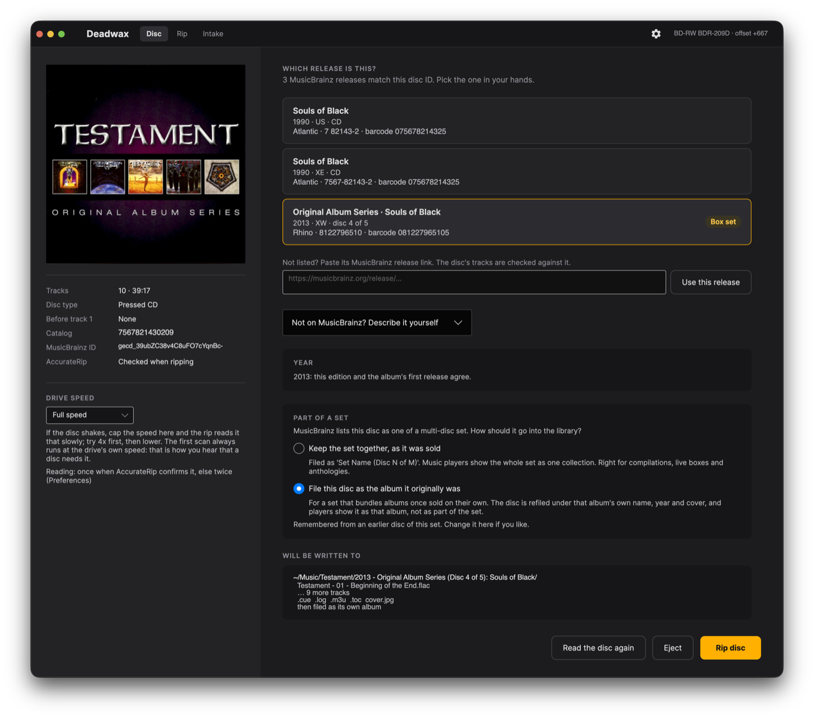
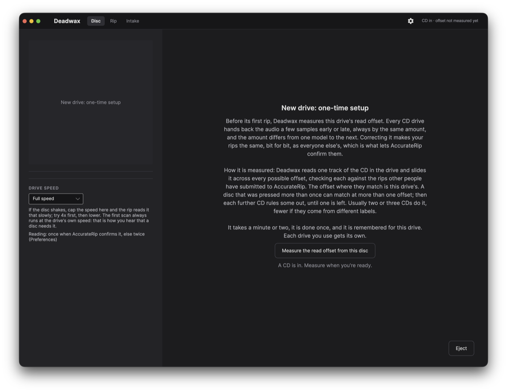
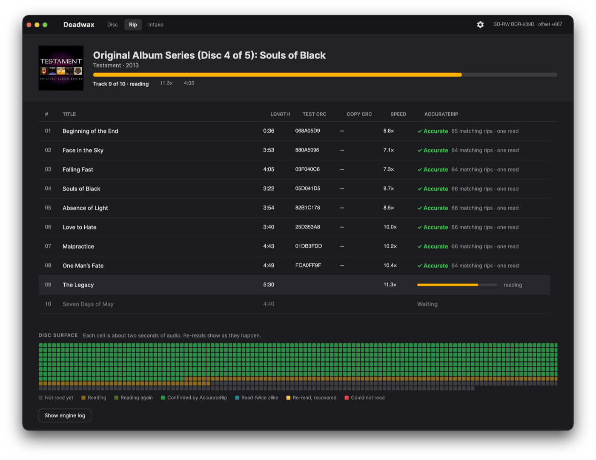
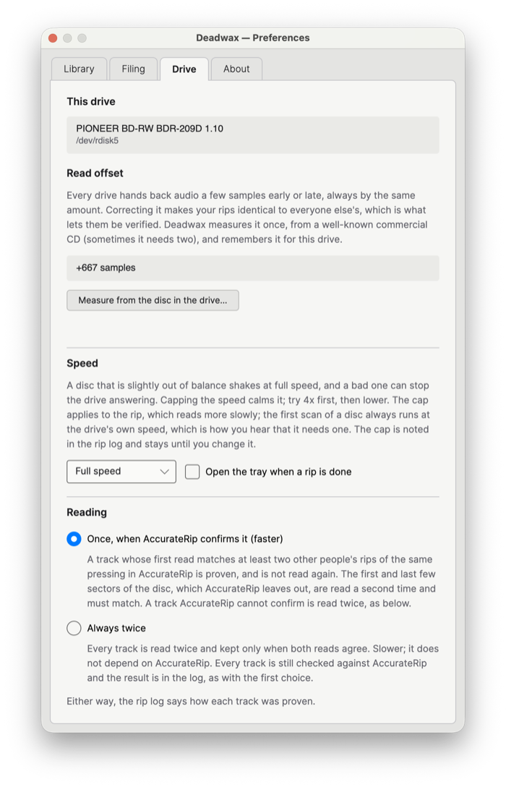
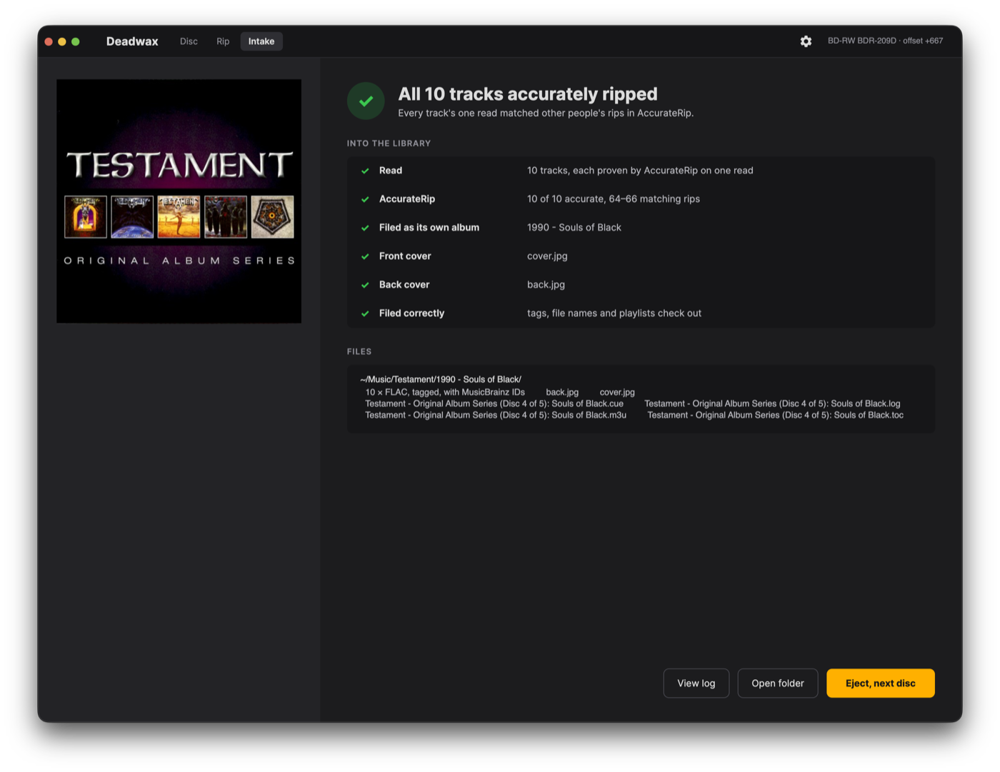
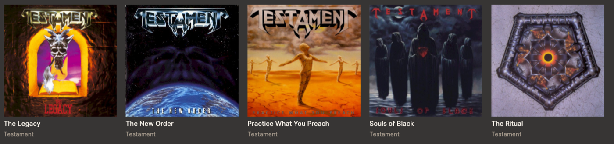

# Deadwax

A CD ripper for a FLAC library you own, and the companion to
[AlbumWall](https://github.com/gsa700/albumwall). It reads the disc itself,
with its own secure reader, verifies every rip against AccurateRip, and files
the album into the library the way the library wants it.

It is in daily use on the author's library since 2026-09-24: every disc
is checked against AccurateRip as it is read, and read again until two passes
agree unless AccurateRip has already confirmed it (since 0.5.0), encoded by
Deadwax's own FLAC encoder (since 0.6.0; libFLAC before), tagged from
MusicBrainz with ReplayGain measured as it rips, and written with `.cue`,
`.m3u`, `.toc` and a rip log in whipper's layout, so a library ripped with
whipper and one ripped with Deadwax look the same. The window shows the disc, its MusicBrainz
releases (with a barcode match against the disc's catalog number), the rip as
it happens with a read map of the disc surface, and the post-rip filing steps.



Linux, Windows and macOS (Apple silicon). All of it is Deadwax's
own code, the drive layer included (since 0.7.4; libcdio and libcdio-paranoia
read the disc before): the drive commands (the system's own SCSI interface on
each platform), the secure read (C2 error flags, re-reads, a best copy of a
damaged track), the disc's pregaps, ISRCs, catalog number and CD-Text,
AccurateRip, the FLAC encoder and decoder (from the format's specification,
RFC 9639), the tags and ReplayGain. The design
is in a spec kept outside the repository, and the build went through its
validation gates in order, each checked against the 309 whipper 0.10.0 rips
already in the library.

## Download

Each [release](https://github.com/gsa700/deadwax/releases) carries one file per
platform:

| your machine | the file |
|---|---|
| Windows 10 or 11 (64-bit) | `Deadwax-win-x64-aot.zip` |
| a Linux PC with glibc 2.34 or later (Ubuntu 22.04, Debian 12, RHEL 9, Fedora 35 and newer) | `Deadwax-linux-x64-aot.zip` |
| a Mac with Apple silicon, macOS 13 or later | `Deadwax.dmg` |

Since 0.8.0 Deadwax is compiled ahead of time (.NET Native AOT): a native
program, no .NET needed, and under half the size of the single-file builds
before it (18-19 MB). On Windows and Linux the zip holds the program with
Avalonia's graphics libraries beside it (the single file kept them inside);
keep them together. Up to 0.7.6 the download was `Deadwax-<system>.zip`,
one file.

- **Windows and Linux:** unpack the zip into a folder and run `Deadwax`
  (`Deadwax.exe` on Windows); it offers to install itself (see
  [Install](#install)). Windows may say "Windows protected your PC" on the
  first run, because the program is not signed: More info, then Run anyway.
- **Mac:** open `Deadwax.dmg` and drag Deadwax to Applications. It is signed
  with a Developer ID and notarized by Apple, so it opens with no warning; on
  its first start it offers to eject the installer image. macOS then asks once
  for the CD drive and once for the Music folder. (`Deadwax-osx-arm64.zip`
  holds the same app, for the updater.)

The Mac download came with 0.7.0; Stable has had it since 0.7.6.

Nothing needs installing. Since 0.7.4 Deadwax carries no native libraries of
its own at all: it talks to the drive and reads the audio with its own code.
From 0.3.1 to 0.7.3 it carried its own builds of libcdio and libcdio-paranoia
(published as `natives-N` pre-releases with the sources attached); releases
before that needed `libcdio`, `libcdio-paranoia` and `flac-libs` from the
distribution, and 0.2.x needed `cdrdao` as well. Since 0.6.0 Deadwax's own
encoder makes the FLACs; libFLAC, which made them before, left the program in 0.6.2.

A running copy checks GitHub for a newer release a few seconds after launch
and, if there is one, offers it in the title bar. The update is verified against
the release's `SHA256SUMS` before it is installed, and Deadwax restarts into it;
if the new version does not start, the old one is put back and says so (Windows
and Linux, since 0.7.6). On Windows and Linux a copy older than 0.7.6 cannot
install 0.8.0 or later itself, because it would take the program without its
libraries: it says the release has no build for it, and the zip is downloaded
from the release page instead.

There are two channels, chosen in Preferences > Updates. **Edge** gets every build
as it is released (published as GitHub pre-releases). **Stable**, the default,
gets a build only once it has run on Edge without trouble and been promoted:
the same binary, with its pre-release flag cleared.

Every drive reads audio a few samples early or late, always by the same
amount: its read offset. The first time Deadwax meets a drive it is not an
error but a one-time setup: Deadwax asks to measure the offset from the CD in
the drive, checked against AccurateRip. A disc pressed more than once can fit
several offsets, so it may ask for another CD; usually two or three do it,
fewer if they come from different labels. The result is remembered in
`~/.config/deadwax/drives.json`, one entry per drive model and firmware, for
example `{"PIONEER BD-RW BDR-209D 1.10": 667}`, and recalled whenever that drive
is plugged in. Several external drives each keep their own entry; a drive
carried to another computer is measured once there too. Preferences shows the
drive and its offset (on Linux with or without a disc in; on a Mac or Windows,
which name a drive only while a disc is in it, once there is one), and every
drive remembered.



For a disc that vibrates in the drive, choose a **Drive speed** on the Disc
screen (16x down to 1x; try 4x first). The cap holds for the scan and the rip,
is remembered for the next disc, and is recorded in the log.

## Reading: once, when AccurateRip confirms it

Since 0.5.0 each track is checked against AccurateRip the moment it has been
read. When at least two other people's rips of the same pressing match, the
read is proven and the track is done. Otherwise it is read again, and kept only
when two reads agree, as every track was before. AccurateRip's checksums leave
out the first and last five sectors of the disc, so on the first and last
track those sectors are read a second time and must match byte for byte.

On a disc AccurateRip knows, that is about half the reading time: a 46-minute
album read in about five minutes on the author's drive, where two passes took
nine for a 39-minute one. Before it was switched on, all 361 two-pass rips in
the author's library were checked against it: the 3,992 tracks it would have
read once all had equal test and copy CRCs.



The read map shows how each track was proven: green when AccurateRip confirmed
it, teal when two reads agreed without it. The rip log says the same per track
(`Reads: 1 (AccurateRip v2, confidence 64)` or `Reads: 2 (test and copy CRCs
match)`); a track read once has no `Copy CRC` line, because no copy was read.
The window calls the two CRCs **Read 1** and **Read 2**; the log keeps
whipper's and EAC's names, Test CRC and Copy CRC, so it reads like theirs.
For every track read twice regardless, choose **Always twice** in Preferences >
Drive > Reading; AccurateRip is still checked and logged. On the command line it
is `deadwax rip --two-passes`.



## After the rip

When every track was proven (by AccurateRip, or by two reads alike), Deadwax finishes the album for the
library (Preferences, Library page, **After a rip**; on by default). Nothing
else needs to be installed for this.



- **Front cover.** `cover.jpg` is the Cover Art Archive's 500-pixel front for
  the release, or for its release group when the release has none. It is
  fetched before the rip starts; if the archive is down, the rip goes ahead
  without it.
- **Back cover** (Preferences > Filing, on by default). It is the back of
  the CD case, usually the track list as printed: [AlbumWall](https://github.com/gsa700/albumwall) turns the sleeve
  over to show it when you open an album. `back.jpg` is the release's own back when the archive has
  one, otherwise the back of another edition of the same album: the same
  country first, then the nearest year. An image filed as the front is never
  taken for the back, even when it is flagged as both. Every back written is
  recorded, with where it came from, in `~/.local/state/deadwax/back-covers.tsv`,
  and one from another edition says so in the log.
- **A disc from a set.** For a release of several discs, the Disc screen asks
  once per set, and remembers the answer for the set's other discs:
  - *Keep the set together, as it was sold*: one album in the library, the way
    a career compilation or a live box should be.
  - *File this disc as the album it originally was*: for "Original Album
    Classics" and other boxes of complete albums. The disc is retagged with
    that album's own title, first-release year and front cover, its folder is
    renamed for that album in your chosen folder style, and the box's back is
    replaced. This happens only
    when the disc's title is found in MusicBrainz as an album or EP by that
    artist; a disc called "Bonus Tracks" or "Dawn to Dusk" stays with its set.
    The old tags and art are kept in `~/.local/state/deadwax/unbox-backup/`
    first, and an existing folder is never written over.

    The Testament *Original Album Series* box shows how it ends up. Its five
    discs all carry the box's name and cover, and MusicBrainz lists each one
    as "Disc N of 5" of the 2013 set, so that is how each disc is found and
    ripped (the Disc screen above). Once it has proven the rip, Deadwax files
    each disc as the album it was: *The Legacy* (1987) through *The Ritual*
    (1992), each in its own folder with its own front and back cover, year and
    title. The rip log keeps the set's name, so every album can still be
    traced to the pressing it came from. (Choose *Keep the set together*
    instead and it stays one release, as sold: each disc filed as
    "Original Album Series (Disc N of 5)" under the box's cover.) Filed as
    albums, in [AlbumWall](https://github.com/gsa700/albumwall) the box is five albums:

    
- **Filed correctly.** The new album is checked against your Filing choices:
  every track tagged and agreeing on album, artist, year and disc, track
  numbers 1 to N, file names in the chosen style, the `.cue` and `.m3u`
  pointing at files that exist, and the cover embedded when asked. Deadwax
  checks only the album it has just made; keeping a whole library in order
  over the years is a job for a separate tool.
- **Two editions of one set.** Before a disc of a set is ripped, Deadwax looks
  for the set's other discs in the library. If one came from a different
  edition, the Disc screen says so and offers to use the same one: most
  players show a set's discs from two editions as two separate albums.

When the archive was down at rip time, `deadwax art ALBUM_DIR` fetches the
missing covers later (`--replace` fetches both again).

## Filing: how the library is laid out

Preferences > Filing. The defaults are shown first; anything you change
applies to new rips only, and albums already in the library are never renamed.

| Choice | Options |
|---|---|
| Album folder | `Artist/1976 - Album` (default), `Artist/Album (1976)`, `Artist/Album`, `Artist - Album` (one level) |
| Track files | `Artist - 01 - Title.flac` (default), `01 - Title.flac`, `01 Title.flac` |
| Embed the front cover in each file | off for an existing setup, on for a fresh install: phones and car stereos show only embedded art |
| Back cover as `back.jpg` | on |
| Write ReplayGain tags | on: track and album loudness, measured while it rips (EBU R128); the audio is not changed |
| `.cue` sheet, `.m3u` playlist | on |

The front cover is always saved as `cover.jpg`, and the rip log (`.log`) and
table of contents (`.toc`) are always written: they are the record that the
rip was verified, and how Deadwax knows a disc is already in your library.

## Files outside the library

| Path | What |
|---|---|
| `~/.config/deadwax/settings.json` | the window's settings, including each set's choice |
| `~/.config/deadwax/drives.json` | drive read offsets |
| `~/.config/deadwax/discs/` | discs described by hand when MusicBrainz has no match |
| `~/.cache/deadwax/musicbrainz/` | MusicBrainz release data (safe to delete) |
| `~/.local/state/deadwax/back-covers.tsv` | where each `back.jpg` came from |
| `~/.local/state/deadwax/unbox-backup/` | tags and art of set discs before they were refiled |

## Status

| Gate | What it proves | State |
|---|---|---|
| G1 · IDs | TOC, MusicBrainz, CDDB and AccurateRip disc IDs, catalog and ISRCs equal whipper's | Offline: all 309 logs and cdrdao TOC files match. Drive: 52nd Street, Turnstiles, Anthology of Bread, Shout at the Devil PASS |
| G2 · Audio | Same audio as whipper, sample for sample | Offline: CRC of all 3,529 tracks in the library matches. Drive: Turnstiles (8 tracks) and Anthology of Bread (20, gap before track 1) read twice, identical, same CRC and FLAC MD5 as whipper |
| G3 · AccurateRip | Same v1/v2 checksums as whipper | Offline: all 1,617 v1 and 3,376 v2 checksums in 309 logs match. Drive: Anthology of Bread, all 20 tracks accurate (79–87 matching rips) and equal to whipper's |
| G4 · Output | Same tags and sidecar files, `music-audit` clean | Tags: 177 of 199 non-box albums identical (the rest is MusicBrainz drift). FLAC (libFLAC, before 0.6.0): byte-identical frames to whipper's. .m3u: 308 of 309 identical (the other was hand-edited, and is wrong). .cue: structure identical on all 306 comparable. Log: written and verifiable. `deadwax rip` works end to end |
| G5 · Side by side | 10 discs through both tools | **PASS, 10 of 10.** Seven identical on every check, art included; the rest differ only by the deliberate `"`→`'` file name, one composer MusicBrainz added after the rip, and his hand-renamed folder. Two naming rules (compilation year, disambiguation) found and fixed on the way |
| FLAC encoder (0.6.0) | Deadwax's own encoder makes the same audio as libFLAC, the same bytes on every platform | **PASS.** All 4,186 FLACs in the library decoded by Deadwax (every frame CRC and the MD5 checked), encoded again, and read back identically by Deadwax and by FFmpeg; 0.01% smaller than the libFLAC originals overall, the worst track 0.65% larger. Same output, byte for byte, on Windows, Linux and macOS (CI). First rip with it: all 13 tracks with the same audio MD5, decoded audio and tags as the libFLAC rip of the same disc |

## Install

Since 0.4.6 a release installs itself. Run it from wherever you unzipped it and
it offers to install, per user and without administrator rights: into
`%LocalAppData%\Programs\Deadwax` on Windows (listed in Installed apps, with a
Start Menu shortcut), or `~/.local/share/deadwax` on Linux (in your
applications menu); both add a desktop shortcut. `--install` and `--uninstall`
do the same from a terminal; add `--quiet` for scripts. It can also be removed
from Preferences > About. Uninstalling keeps the drive offsets, the discs
described by hand and the set backups; your settings go only if you tick that
box, the MusicBrainz cache goes with the program, and your music is never
touched. An installed copy updates itself in place.

To run it from a folder or a USB stick and register nothing with the system,
put an empty file named `portable.txt` beside it.

From source: `tools/install.sh` builds Deadwax ahead of time (Native AOT, as
releases are; it needs clang and zlib's development files) into
`~/.local/share/deadwax/` and adds it to the app menu with its icon (the app
then counts as installed); rerun it after changes, and `tools/install.sh
--remove` takes it out.

On a Mac, the app installs the Mac way: drag it from `Deadwax.dmg` into
Applications, and it updates itself in place from there (since 0.7.0; not
while it runs from the disk image). From source, `tools/make-macos-app.sh
--install` builds `Deadwax.app` into Applications.

## Build and run

Needs the .NET 10 SDK, nothing else. cdrdao is only needed by
`deadwax subchannel --cdrdao`, which compares Deadwax's reading with it.

A release build is compiled ahead of time on the system it is for, since
Native AOT cannot build for another one:
`dotnet publish src/Deadwax.App -c Release -r linux-x64 -p:PublishAot=true`
(`win-x64`, `osx-arm64`). Linux needs clang and zlib's development files for
that, Windows the Visual Studio C++ build tools. Releases take the Linux and
Windows builds from CI (Linux on Ubuntu 22.04, which sets the glibc it needs)
and make the Mac's on a Mac (`tools/release.sh`).

```
dotnet build
dotnet test
dotnet src/Deadwax.Cli/bin/Debug/net10.0/deadwax.dll check-logs ~/Music --online 8
dotnet src/Deadwax.Cli/bin/Debug/net10.0/deadwax.dll check-audio ~/Music
dotnet src/Deadwax.Cli/bin/Debug/net10.0/deadwax.dll scan --full --online --against "~/Music/Billy Joel/1978 - 52nd Street"
dotnet src/Deadwax.Cli/bin/Debug/net10.0/deadwax.dll read --against "~/Music/Billy Joel/1976 - Turnstiles"
```

`check-logs` rebuilds the TOC from every whipper log under a folder and checks
the IDs Deadwax computes against the ones whipper recorded. `check-audio` decodes
whipper's FLACs (with the `flac` tool) and checks the copy CRC and AccurateRip
v1/v2 checksums of that audio against the log: G2 and G3 without the drive. `scan` reads the disc
in the drive; with `--against` it compares the TOC and IDs to that album's
whipper log. `--full` adds the subchannel pass (a few seconds) for the
catalog number, ISRCs, CD-Text and pregaps, and compares those with the cue.
`rip` makes a complete album; with `--post-rip` it then does the steps under
[After the rip](#after-the-rip) (a set's disc is refiled only with
`--unbox`), and `post-rip DIR` does them for an album already ripped. `art DIR`
fetches a missing `cover.jpg` and `back.jpg`. `compare` checks a
Deadwax rip against whipper's rip of the same disc. `read` reads tracks securely, twice, at the drive's read offset
(from `drives.json`, or `--offset`), and with `--against` checks each track's audio
against whipper's logged CRC and the MD5 stored in the existing FLAC. It writes
nothing.

## Layout

```
src/Deadwax.Drive      the drive itself (SG_IO on Linux, SPTI on Windows, the CD
                       ioctls and DiskArbitration on macOS): TOC, drive identity,
                       speed, tray; secure reads with C2, re-reads, the best copy
                       and offset correction; the subchannel reader (catalog,
                       ISRCs, CD-Text, pregaps) and cdrdao's TOC file format
src/Deadwax.Metadata   disc IDs; MusicBrainz client, tags and library conventions;
                       front and back covers from the Cover Art Archive
src/Deadwax.Verify     AccurateRip IDs, database and checksums; CRC32/MD5 audio
                       checks; whipper log, cue and config readers
src/Deadwax.Output     the FLAC encoder and decoder (RFC 9639), tags, file names,
                       .cue/.m3u, the rip log
src/Deadwax.Core       the rip session and the steps after it (set discs refiled,
                       back cover), shared by the command line and the window
src/Deadwax.Cli        the deadwax command
src/Deadwax.App        the window (Avalonia, native Wayland) and its updater
tests/Deadwax.Tests    golden files from real rips
```

## License

GPLv3. What a release carries, and under which licenses:
[THIRD-PARTY-NOTICES.md](THIRD-PARTY-NOTICES.md).
